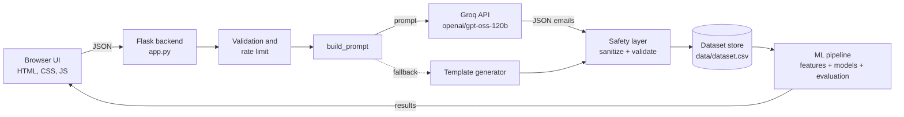

# 🛡️ PhishSynth AI: Synthetic Phishing Email Generator


**PhishSynth AI** generates **safe, labelled, placeholder-only phishing-style emails** and uses them to train and evaluate a phishing-detection classifier. It is a defensive synthetic-data pipeline for cybersecurity research and detection-model development.

> ⚠️ **Defensive use only.** All output uses placeholders such as `[COMPANY]`, `[USER]` and `[SAFE-LINK]`. There are no real brands, URLs, addresses, phone numbers, malware or attack instructions. Samples are non-deployable simulations.

---

## 📌 Why this project?

Security teams need diverse data to train phishing detectors, but real phishing samples are **scarce, sensitive and slow to reflect new tactics**. PhishSynth AI creates controlled synthetic samples that cover different manipulation patterns, labelled automatically, so detection models can be built and refreshed quickly.

## ✨ Features

- **8 phishing categories + 1 benign category:** urgency, authority impersonation, fear/threat, reward bait, shared-document lure, invoice fraud, credential reset, callback scam, legitimate.
- **Style and difficulty controls:** formal, casual, terse, polished (AI-written) tones, and obvious or subtle samples.
- **Hybrid generation:** a Groq-hosted model (`openai/gpt-oss-120b`) first, with a built-in template generator as a safe fallback, so it works offline too.
- **Diversity-aware prompting:** ten explicit diversity requirements in every prompt (unique subjects, varied openings and structure, different scenarios, no paraphrases) and temperature 0.9.
- **Multi-layer safety:** prompt rules, sanitiser, validator and blocklist on every sample.
- **Dataset builder:** bulk generation, duplicate removal, quality report, CSV and JSONL export.
- **Detection baseline:** TF-IDF plus handcrafted cue features with Logistic Regression, Naive Bayes or Random Forest.
- **Honest evaluation:** held-out-category test, easy vs hard accuracy, 5-fold CV, and upload of your own labelled CSV.
- **Live detector:** paste an email and see the label, probability and cue words.
- **Modern UI:** dark glassmorphism, responsive, with copy-to-clipboard.

## 🖼️ Screenshots

| Generate | Dataset | Train & Evaluate |
|---|---|---|
|  |  |  |

*(Add your own screenshots to `docs/screenshots/`.)*

## 🏗️ Architecture



### Generation flow

1. The request is validated (category, style, difficulty, count 1 to 10, optional hint).
2. If a Groq key is set, `build_prompt()` (category, tone, difficulty, optional hint, diversity requirements and safety rules) is sent to the model, and `extract_json()` parses the reply.
3. Every email passes `sanitize()` then `validate()`. Unsafe emails are dropped.
4. Missing emails are topped up from templates, so the requested count is always met. If Groq cannot be used, the UI shows the reason (missing key, package not installed, initialisation or API error) and the error is logged.
5. The label comes from the category in code, never from the model.
6. Rows are stored, with duplicates rejected.

## 📂 Project structure

```
phishsynth_ai/
├── app.py              # Flask routes, build_prompt, extract_json, Groq call, rate limiter
├── run_public.py       # Ngrok launcher
├── requirements.txt
├── .env.example
├── core/
│   ├── taxonomy.py     # categories, tones, difficulty, placeholders
│   ├── safety.py       # sanitize() + validate()
│   ├── offline.py      # template generator (fallback + bulk)
│   ├── store.py        # dataset store (CSV)
│   └── ml.py           # preprocessing, features, models, evaluation, quality report
├── templates/index.html
├── static/css/style.css
├── static/js/main.js
├── docs/               # SPEC.md, REPORT_TEMPLATE.md
├── data/               # generated datasets (git-ignored)
└── tests/test_app.py
```

## 🚀 Quick start

### 1. Clone and install

```bash
git clone https://github.com/<your-username>/phishsynth-ai.git
cd phishsynth-ai

python -m venv myenv
# Windows
myenv\Scripts\activate
# macOS / Linux
source myenv/bin/activate

pip install -r requirements.txt
```

### 2. Add your keys

```bash
cp .env.example .env        # Windows: copy .env.example .env
```

```env
GROQ_API_KEY=your_groq_api_key_here
NGROK_AUTHTOKEN=your_ngrok_authtoken_here   # only needed for public sharing
```

Get a free Groq key at [console.groq.com](https://console.groq.com). **No key? No problem:** the app runs in template mode.

**Changing the model:** edit the `MODEL` constant near the top of `app.py` (currently `openai/gpt-oss-120b`), and adjust `temperature` (0.9) or `max_tokens` (2048) in `groq_emails()` if needed. Pick any chat model available in your Groq console.

### 3. Run

```bash
python app.py
```

Open **http://127.0.0.1:5050**.

### 4. (Optional) Share publicly with Ngrok

```bash
python run_public.py
```

The terminal prints a public URL. `debug=False` is required here so Flask does not start a reloader that disturbs the tunnel.

### 5. Run the tests

```bash
pytest -q
```

> `httpx==0.27.2` is pinned because `groq==0.11.0` breaks with newer httpx versions.

## 🧭 How to use

1. **Generate:** choose a category, style, difficulty and count, then click *Generate samples*.
2. **Dataset:** choose samples per category and the benign ratio, then *Build dataset*. Use *Remove near-duplicates*, then download CSV or JSONL.
3. **Train & evaluate:** pick a model and click *Train & evaluate*. Read the diagnosis and advice.
4. **Check:** paste an email into *Try the detector*, or upload a real labelled CSV (`subject, body, label`).
5. Refine the data and repeat.

## 🗂️ Dataset schema

| Field | Description |
|---|---|
| `id` | Unique 8-character id |
| `subject`, `body` | Email text (placeholders only) |
| `label` | `1` phishing, `0` legitimate |
| `category` | One of the 9 taxonomy keys |
| `style` | formal, casual, terse or polished |
| `difficulty` | easy or hard |
| `indicators` | Pipe-separated manipulation cues |
| `source` | `groq` or `template` |
| `safety_passed` | Passed the safety validator |
| `created_at` | UTC timestamp |

**Allowed placeholders:** `[COMPANY]` `[USER]` `[SAFE-LINK]` `[PHONE]` `[AMOUNT]` `[DATE]` `[EMAIL]`

## 🔌 API

| Endpoint | Purpose |
|---|---|
| `POST /generate` | Generate 1 to 10 samples (`category, style, difficulty, count, context, save`) |
| `POST /dataset/build` | Bulk build (`per_category, legit_ratio, use_groq`) |
| `GET /dataset` | Quality summary and latest rows |
| `POST /dataset/refine` | Remove near-duplicates |
| `POST /dataset/clear` | Empty the dataset |
| `GET /dataset/download?fmt=csv\|jsonl` | Export |
| `POST /train` | Train and evaluate (`model, test_size`) |
| `POST /predict` | Classify one email |
| `POST /evaluate_upload` | Score the model on your own labelled CSV |

Errors return JSON: `400` invalid input, `429` rate limited (40 POSTs per minute per IP), `500` server error.

## 🧠 ML pipeline

- **Cleaning:** lowercase, placeholders turned into word tokens, punctuation removed.
- **Features:** TF-IDF (words and word pairs) + 10 cue features (length, caps ratio, exclamations, link and placeholder counts, urgency, threat, reward and credential cues), scaled and combined with `FeatureUnion`.
- **Models:** Logistic Regression, Multinomial Naive Bayes, Random Forest.
- **Evaluation:** accuracy, precision, recall, F1, confusion matrix, 5-fold CV, per-category recall, held-out-category recall, per-difficulty accuracy, top features, misclassified examples, dataset-quality report and advice.

## 📊 Results (one controlled run, template mode)

| Measure | Result |
|---|---|
| Dataset | 586 samples (310 phishing, 276 legitimate), 0 safety violations |
| Accuracy on synthetic test split | 100% (all three models) |
| Accuracy on 24 hand-written emails | Logistic Regression **91.7%**, Naive Bayes 79.2%, Random Forest 54.2% |
| Held-out category recall | 100% for 7 categories, **0% for callback scams** |
| Near-duplicates before / after refine | 278 (47%) / 19 |

**Key takeaways**

- Perfect scores on synthetic data are misleading, so always test on independent or real data.
- Cue features raised accuracy on new emails from about 54% to 92% compared with TF-IDF alone.
- The limit is generator variety, not row count. Removing duplicates improved diversity but not accuracy.

> These results come from template mode, which does not call the language model, so the Groq model choice does not affect them. The 24-email test set is small and team-written, so treat it as an indicator, not a benchmark. Template-mode runs use random sampling, so exact numbers can vary slightly.

## 🔒 Safety and responsible use

| Layer | Control |
|---|---|
| Prompt | Placeholder-only, no-attack and diversity rules in every model request |
| Sanitise | Links, addresses, phone numbers and 20 real brand names are replaced |
| Validate | Rejects raw URLs, addresses, numbers, brands, unknown placeholders and blocked terms (malware, card or wallet data, executable attachments) |
| Fail closed | Unsafe model output is dropped, never silently repaired |
| Audit | `source` and `safety_passed` stored on every row |
| Abuse control | Per-IP rate limit |
| Secrets | Keys live in `.env`, which is git-ignored |

Intended for defensive research, classifier development and security-awareness design. **Do not use it to build or run phishing campaigns.**

## ⚠️ Limitations

- English, plain text only (no headers, HTML, images or attachments).
- Template mode is repetitive. The Groq path was tested with a mock client, not the live service, so the output quality of `openai/gpt-oss-120b` has not been measured. Reasoning-style models can spend part of the token budget on reasoning, so if replies look cut off, raise `max_tokens`.
- Baseline models only, not production detectors.
- Local CSV storage, with no user accounts.
- Pattern-based safety filters cannot catch every unsafe phrase.

## 🛣️ Roadmap

- [ ] More categories (SMS phishing, MFA fatigue, conversation hijacking)
- [ ] More benign and hard-negative templates
- [ ] Multi-language generation
- [ ] Transformer baseline (DistilBERT)
- [ ] Header and URL-structure features
- [ ] Dataset versioning and user history
- [ ] Larger real-world evaluation set

## 🧰 Tech stack

Python · Flask · Groq API (`openai/gpt-oss-120b`) · scikit-learn · pandas · NumPy · pyngrok · HTML/CSS/JavaScript · pytest

## 📄 License

Add your license here (for example MIT). Remember to state the defensive-use intent in your license or notice.

## 🙌 Acknowledgements

Architecture and workflow inspired by the CaptionAI project (Flask + Groq + Ngrok).
